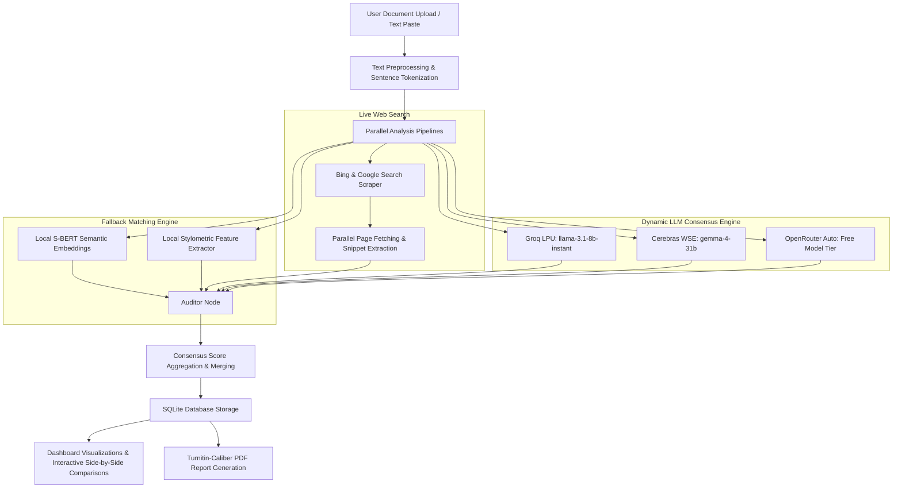

# 🛡️ ApexAudit AI - Enterprise Academic Integrity Platform

[](https://python.org)
[](https://flask.palletsprojects.com/)
[](https://css-tricks.com/)
[](https://cloud.cerebras.ai)

ApexAudit AI is a premium, state-of-the-art academic integrity auditing platform. It leverages a **Dynamic Multi-LLM Consensus Ensemble Engine** working alongside local semantic embeddings (S-BERT) and real-time multi-tier web index scraping to provide unparalleled detection accuracy for plagiarized text and AI-generated content.

---

## 🏗️ Technical Architecture & Workflow



---

## ✨ Features & Capabilities

- **Dynamic Multi-LLM Consensus Ensemble**: 
  - Concurrently queries **Groq** (extremely fast LPU inference), **Cerebras** (ultra-low latency WSE inference), and **OpenRouter** in parallel threads.
  - Merges scoring metrics, resolves matched source urls, and merges technical explanation logs.
  - Automatically degrades to active providers if any credential is missing or hits rate limits.
- **Turnitin-Grade Prompt Calibration**:
  - Leverages in-context **Few-Shot Prompt Training** to align all cloud models with academic auditing rubrics (Lexical Matches, Syntactic Paraphrases, Mosaic Plagiarism, and Stylometric Perplexity Indicators).
- **Hybrid Live Web Scanning**:
  - Scrapes Google and Bing in parallel.
  - Fetches page contents concurrently using thread pools. Uses fallback description snippets if a target domain rejects raw scrapers.
- **Modern Sapphire Navy Aesthetics**:
  - Stunning steel-navy translucent glassmorphism dashboard, platinum scrollbars, and high-contrast typography optimized for high-definition monitors.
- **Professional PDF Reports**:
  - Generates detailed audit summaries with risk assessment badges and sentence-level matrices ready for academic panels.
- **Interactive Side-by-Side Comparisons**:
  - Highlights plagiarism in crimson overlay and AI generation in purple overlay with interactive side-by-side scroll panes.

---

## 🛠️ Tech Stack & Libraries

- **Backend**: Python 3.10+, Flask
- **Core NLP / AI**: `sentence-transformers` (S-BERT), `nltk` (Tokenization), `scikit-learn` (TF-IDF Cosine Similarity)
- **Scraping**: `BeautifulSoup`, `requests`
- **PDF Engine**: `fpdf`
- **Database**: SQLite3
- **Frontend**: HTML5, Vanilla CSS, Chart.js

---

## 📦 Setup & Installation

### 1. Prerequisites
Ensure you have Python 3.10 or higher installed.

### 2. Clone the Repository & Setup Environment
```bash
# Navigate to workspace
cd PlagiarismChecker

# Create virtual environment
python -m venv .venv

# Activate virtual environment
# On Windows:
.venv\Scripts\activate
# On Linux/macOS:
source .venv/bin/activate

# Install required dependencies
pip install -r requirements.txt
```

### 3. Configure API Credentials
Create or edit the `.env` file in the project root:

```env
# Flask Secret Key
SECRET_KEY=super_secure_extreme_key_change_this_in_production

# Database Path
DATABASE_PATH=plagiarism_checker.db

# Upload Folder
UPLOAD_FOLDER=uploads

# Groq Cloud API Key (https://console.groq.com/keys)
GROQ_API_KEY=your_groq_api_key_here

# Cerebras Cloud API Key (https://cloud.cerebras.ai)
CEREBRAS_API_KEY=your_cerebras_api_key_here

# OpenRouter API Key (https://openrouter.ai/keys)
OPENROUTER_API_KEY=your_openrouter_api_key_here
```

### 4. Running the Server
```bash
python app.py
```
Open **[http://127.0.0.1:5000](http://127.0.0.1:5000)** in your browser.

---

## 🧪 Running Integrity Audits (Diagnostics)
To verify that all backend engines, database schemas, and LLM routes are properly configured, run the test script:
```bash
python scratch/verify_app.py
```
This runs 15 end-to-end integration tests confirming routes, PDF exports, and database interactions are operating correctly.
